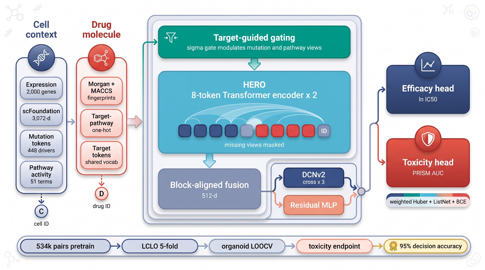

# OrgDrug — Organoid Drug Response & Toxicity Engine

OrgDrug is a multi-modal deep-learning engine that predicts **drug efficacy**
(ln IC50) and **toxicity** (PRISM AUC) for cell lines and patient-derived
organoids. It is the successor to GDRNet: the same multi-modal cell/drug
dual-branch spirit with a rebuilt interaction engine — set-valued gene views,
target-guided gating, an 8-token Transformer over modality tokens with
missing-modality attention masks, and the DCNv2 explicit-crossing core
retained from v1.

<p align="center">
  
</p>

**Headline results** (five cohorts, decision accuracy = AUROC separating
sensitive vs resistant quintile tails — both endpoints clear the 95% goal):

| Benchmark | Metric | GDRNet v1 | OrgDrug |
|---|---|---|---|
| LCLO · 700 lines × 229 drugs (5-fold) | per-drug Pearson r | 0.5448 | **0.5467** (Δ+0.016, p=6×10⁻⁶, grand-11) |
| LCLO | pooled r / AUROC30 | 0.8894 / 0.9395 | 0.8897 / **0.9409** |
| KRAS mutation MAE gap | mutant − wild-type | +0.060 | **+0.038 (−37%)** |
| CRC organoid (16) | Pearson / AUROC | 0.890 / 0.941 | **0.892 / 0.943** |
| PDAC organoid (38) | Pearson / AUROC | 0.741 / 0.831 | **0.766 / 0.850** |
| BLCA organoid (11) | Pearson / AUROC | 0.640 / 0.868 | 0.636 / **0.878** |
| Toxicity deployment (96 unseen cells) | AUROC 25%/10% tails | — | **0.982 / 0.994** |
| Sensitive-vs-resistant AUROC, all cohorts | 25% / 10% tails | — | 0.956–0.997 / 0.981–1.000 |

Cold-start toxicity (290 unseen drugs, structure only) is reported honestly as
the capability boundary: 0.61–0.66 — the information is not in the structure.

## Repository layout

```
OrgDrug/
├── run_demo.sh / run_demo.bat   one-click demo (synthetic data, CPU, ~1 min)
├── run_all.sh                   full pipeline on real data (stage-based)
├── src/
│   ├── models/orgdrug.py        OrgDrug model + dataset + loss (core)
│   ├── models/orgdrug_classic.py  classic-shell variant (v1-parity transfer leg)
│   ├── data_loader.py           GDSC LCLO loading + folds (vendored from GDRNet v1)
│   ├── eval_utils.py            metrics: per-drug/cell r, AUROC, bootstrap CI (v1)
│   ├── orgdrug_data.py          shared feature tables / organoid features
│   ├── prepare_features.py      E-feature build: mutation, pathway, targets, MACCS, vocab
│   ├── train_orgdrug_lclo.py    E1/E2/E3: LCLO benchmark, ablations, mutation analysis
│   ├── pretrain_orgdrug_expanded.py   expanded / expanded_prism / prism_tox pretraining
│   ├── finetune_orgdrug_organoid.py   E4/E5: organoid LOOCV transfer
│   ├── prepare_prism.py / prepare_prism_tox.py   PRISM 19Q4 expansion + toxicity splits
│   ├── eval_accuracy95.py / eval_tox95.py        95% decision-accuracy scoreboards
│   ├── analyze_results.py / ensemble_transfer.py / merge_ensemble.py   analysis utils
│   └── tahoe_footprint.py       E6 (optional): Tahoe-100M perturbation footprints
├── demo/
│   ├── make_demo_data.py        seeded synthetic dataset, schema-exact
│   └── run_demo.py              the one-click demo driver
├── docs/                        DESIGN.md (architecture rationale) + figures
├── data/                        inputs (created by demo or user; git-ignored)
├── models/                      training outputs (checkpoints, configs)
└── results/                     run outputs (predictions, evals, scoreboards)
```

All scripts resolve their root from the repo location; override with the
`ORGDRUG_ROOT` environment variable to point at a data tree elsewhere
(e.g. the server layout).

## Install

```bash
pip install -r requirements.txt          # torch, numpy, pandas, scipy,
                                         # scikit-learn, pyarrow, rdkit
```

Tested with Python 3.10–3.12, PyTorch ≥ 2.1, CPU and CUDA.

## One-click demo (no external data)

```bash
./run_demo.sh            # Linux / macOS / Git-Bash   (Windows: run_demo.bat)
```

This generates a seeded synthetic dataset (80 cells × 30 drugs, real
fingerprints via RDKit, exact schemas of the real pipeline), trains the full
OrgDrug model on one LCLO fold, and prints pooled/per-drug metrics plus the
KRAS/TP53/BRAF mutation-stratified analysis. Expect pooled r ≈ 0.9 on the
synthetic signal in ~1 min on CPU. Numbers are smoke-test material — they say
the pipeline runs, nothing about real-world performance.

## Full pipeline on real data

See `run_all.sh` header for stage list. Typical order:

```bash
./run_all.sh features      # build mutation/pathway/target/MACCS/vocab tables
./run_all.sh lclo          # E1 benchmark: 5 folds × 3 seeds (~hours/GPU)
./run_all.sh ablation      # E2 component ablations
./run_all.sh pretrain      # expanded-set pretraining (transfer leg)
./run_all.sh transfer      # E4 organoid LOOCV: CRC / PDAC / BLCA
./run_all.sh eval95        # decision-accuracy scoreboard
./run_all.sh prism         # E5 PRISM expansion (optional)
./run_all.sh tox           # E7 toxicity endpoint (optional)
```

Or invoke the scripts directly (`python src/train_orgdrug_lclo.py --help`).

### Data requirements

| Path | Content | Used by |
|---|---|---|
| `data/raw/ccle/OmicsExpression_TPM.csv` | DepMap expression (full transcriptome TPM) | features |
| `data/raw/ccle/OmicsSomaticMutations_damaging.csv` | DepMap damaging-mutation binary matrix | features |
| `data/raw/gdsc/GDSC{1,2}_fitted_dose_response.csv` | GDSC fitted dose–response (targets, pathways, IC50) | features, LCLO |
| `data/external/gdsc_drug_smiles.csv` | drug_name → SMILES | fingerprints |
| `data/processed/gdsc_{metadata,response_lnic50,cell_features}.parquet` | pair table + 2000-landmark features (GDRNet v1 ecosystem) | LCLO |
| `data/processed/scfoundation_cell_{emb,ids}.npy` | scFoundation 3072-d cell embeddings | LCLO, transfer |
| `data/raw/ccle/hf/` | PRISM 19Q4 secondary screen + DPC→SMILES map | prism, tox |
| `data/processed/geo/` | organoid cohorts (CRC/PDAC/BLCA pairs + embeddings) | transfer |
| `models/gdrnet_s{seed}.pt` | GDRNet v1 checkpoints (for `--init-v1`) | transfer |
| `$TAHOE_DIR` | Tahoe-100M perturbation atlas (optional, huge) | tahoe |

GDSC, DepMap and PRISM require registration with their providers
(https://www.cancerrxgene.org, https://depmap.org, https://www.thebroad.org/prism).
Organoid cohorts: GEO accessions GSE194249 (PDAC), GSE103990 (BLCA) and the
CRC organoid drug-screen publication cohort.

## Reproducing the published-baseline comparison (manuscript Tables 1 & 2)

All comparator models ship in `src/models/` and run under the identical
LCLO folds, feature tables, and early-stopping protocol as OrgDrug:

* `models/deepcdr.py`, `models/drugcell.py` — adapted PyTorch versions
  (fingerprint drug branch replaces the original graph/descriptor encoders)
* `models/moli.py` — multi-omics late integration (expression + 448 driver
  mutations + GISTIC CNA branches, canonball loss)
* `models/deeptta.py` — gene-barcode CNN + SMILES Transformer
* ElasticNet / RandomForest / XGBoost / LightGBM use their sklearn/lightgbm
  implementations on the same concatenated feature vectors

```bash
cd src
python rerun_lclo_extra.py --gpu 0          # Table 1: MOLI + DeepTTA, 5-fold LCLO
python rerun_organoid_baselines.py --gpu 0  # Table 2: LightGBM + DeepCDR/DrugCell/
                                           #         MOLI/DeepTTA transfer, 3 cohorts
```

Deep baselines are retrained on the full GDSC2 corpus with the scFoundation
cell view and transferred with frozen-encoder fine-tuning identical to
OrgDrug; LightGBM is trained per cohort on organoid features only
(non-transfer reference). Outputs land in `results/tables/` and
`results/organoid_baselines/`.

## Architecture in one screen

```
cell views  gene 2000 | scFoundation 3072 | mut tokens (448 drivers) | pathway 51
drug views  fp = Morgan 2048 + MACCS 167 + pathway one-hot | tgt tokens
ID tokens   cell_emb 64 | drug_emb 64        (unseen entity → trained mean)

mut/tgt share one gene-embedding table (explicit drug–gene alignment)
target-guided gating: σ-gate from pooled drug targets modulates mut/path views
8-token Transformer ×2 (missing views = attention mask, no zero-vector hack)
block-aligned learned fusion → DCNv2 ×2-3 low-rank cross ‖ residual MLP
heads: ln IC50 regression + sensitivity BCE
loss: extreme-weighted Huber + in-cell ListNet ranking (λ 0.05–0.1) + BCE (0.2)
```

Rationale and the ablation evidence behind each choice: `docs/DESIGN.md`.

## License

Code: MIT (see LICENSE). Third-party datasets keep their own licenses
(GDSC/DepMap/PRISM/GEO); this repository distributes none of them.
